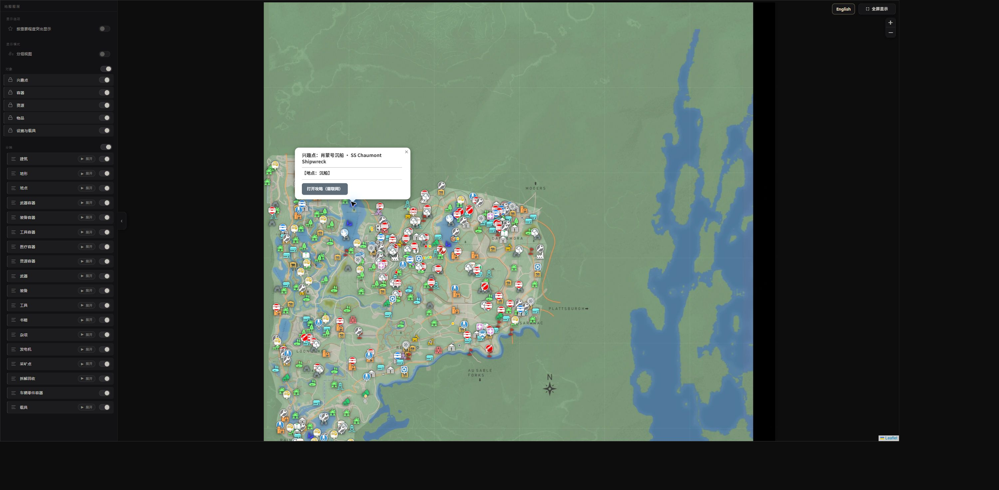

# VEIN MAP

**离线可读的 VEIN 地图与中文攻略。下载到本地后，地图、标记、图片和已收录攻略均可离线使用。**

本项目在原作者地图和攻略的基础上，整理本地资源、提供中文显示，并把已收录内容之间的链接改为本地跳转。支持一键中英切换，不依赖在线翻译服务。

## 主要功能

- **本地阅读**：地图底图、标记、图标、文章图片、样式和脚本随项目保存；运行时无需访问原站。
- **中文汉化**：地图界面、分类、地点、说明及已收录文章支持中文／英文切换。地图专有地名保留英文对照。
- **完整地图交互**：保留缩放、平移、筛选、分组、重要程度显示、地点弹窗和全屏功能。
- **本地攻略跳转**：首页、攻略页和地图弹窗之间直接跳转；武器与工具文章共用本地地图，并保留各自的筛选预设。
- **清爽阅读**：移除评论、广告、访问统计、原站页眉页脚和无关站外入口。

当前快照包含 **497 条地图标记、723 张地图瓦片、43 个 SVG 图标、9 篇攻略**，以及约 **1475 条中英显示词条**。



## 快速开始

### Windows

1. 点击仓库的 **Code → Download ZIP**，并完整解压。
2. 确保已安装 Python 3.11，或系统可通过 `python` 命令运行 Python 3。
3. 双击 **`Start-Map.cmd`**，浏览器会自动打开。
4. 保持命令行窗口开启；结束使用后关闭窗口即可。

### 其他系统或手动启动

```bash
python3 server.py
```

Windows 也可执行：

```powershell
py -3.11 server.py
```

默认地址是 **http://127.0.0.1:18765/**。如果端口被占用，会自动选择其他端口，并在启动窗口中显示。服务仅监听本机地址。

**不要直接双击 `index.html`。** 地图需要通过本地 HTTP 服务读取数据。项目运行只使用 Python 标准库，无需 `pip install`、Node.js 或数据库。

## 已收录攻略

| 攻略 | 本地文件 |
| --- | --- |
| 武器、弹药与高级物资地点 | [713.html](guides/713.html) |
| 液压工具与高级工具地点 | [1172.html](guides/1172.html) |
| 机械技能 | [2086.html](guides/2086.html) |
| 生存攻略合集 | [1963.html](guides/1963.html) |
| 技能机制、开局选择与升级 | [543.html](guides/543.html) |
| 医疗技能 | [2798.html](guides/2798.html) |
| 烹饪技能与食谱 | [2313.html](guides/2313.html) |
| 水下洞穴与沉船 | [2010.html](guides/2010.html) |
| 寂静深渊：缺氧区域探索 | [976.html](guides/976.html) |

这些 HTML 链接用于说明文件位置；实际阅读请先启动本地服务，再从首页进入。

## 数据与翻译

- 快照日期：**2026-10-22**。不会自动同步原站或游戏更新。
- 中文为非官方译文；部分地名、工具名和特长名可能与游戏内汉化不同，可切回英文核对。
- 底图和文章截图内的文字属于图片内容，未重绘汉化。
- 游戏机制和物资刷新结论来自原作者攻略，本项目未逐项重新进行游戏实测。
- 生存攻略合集里提到但未收录的其他文章，不提供站外跳转；本项目不代表原站全部内容。

## 验证

```bash
python3 scripts/verify.py
```

验证脚本仅使用标准库，检查来源资源哈希、497 条标记、中英文坐标与 ID 一致性，以及本地文章的链接和资源路径。浏览器检查记录与边界见 [验证结果.md](验证结果.md)。

## 致谢

特别感谢 **[@lonely-player1 — Solo Gamer's journey](https://lost-in-games.com/)** 整理并持续维护 VEIN 的交互地图、标记、截图和机制攻略。本项目的地图及攻略内容建立在这些工作的基础上，重点贡献是**本地离线整理与中文展示**，并非从零制作地图或原创所有攻略。

这里的 `@lonely-player1` 使用原站评论中显示的作者署名，链接指向原站；尚未确认其 GitHub 账号，因此没有关联未经核实的同名账号。

感谢 **Ramjet Studios** 制作《VEIN》，以及 **Leaflet** 提供地图交互库。

来源页面列表、第三方文件与权利归属见 [THIRD_PARTY_NOTICES.md](THIRD_PARTY_NOTICES.md) 和 [resource-manifest.json](resource-manifest.json)。原作者内容、游戏素材、字体及库文件的权利归各自权利人；本仓库未将这些第三方内容重新授予统一的开源许可证，也不表示原作者对本项目的授权或背书。
